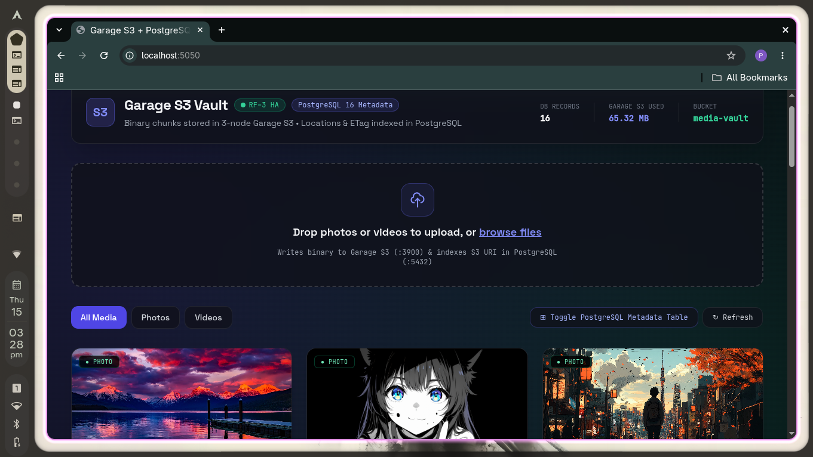
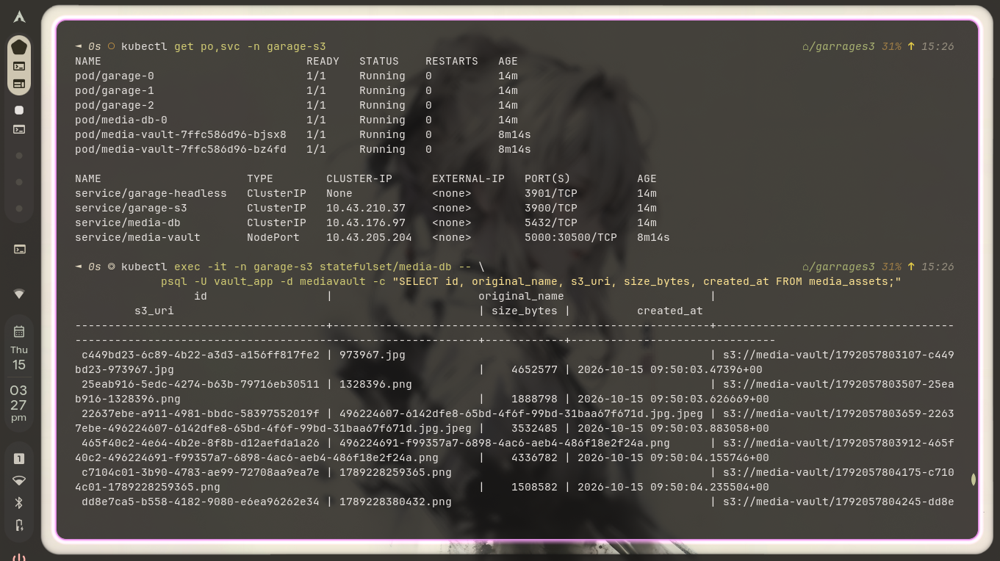

# Cloud-Native Distributed Object Storage on Kubernetes (Garage S3 + PostgreSQL HA)

A production-modeled, self-hosted S3-compatible object storage platform deployed on a multi-node **k3d (K3s in Docker)** cluster on **Arch Linux**. 

Instead of relying on AWS S3, this project provisions a **3-replica Garage S3 StatefulSet** with quorum-based replication (`RF=3`), isolated metadata/data PersistentVolumeClaims (PVCs), zero-trust Kubernetes `NetworkPolicy` segmentation, least-privilege S3 capability keys, and a **PostgreSQL 16** metadata store backing a containerized Node.js media streaming gateway.

<p align="center">
  
</p>

<p align="center">
  
</p>


Apply the garage.yaml for s3 pods 

Run the bootstrap script to join the 3 replicas over headless DNS, assign `zone-a`, `zone-b`, and `zone-c`, create the `media-vault` bucket, and inject the least-privilege S3 credentials into the `media-s3-creds` Kubernetes Secret:

```bash
chmod +x 02-bootstrap-garage.sh
./02-bootstrap-garage.sh
```
```bash
cd media-vault-app
docker build -t media-vault:v2 .
```
import the media image into your cluster or push to dockerhub and update the image tag in mediavault manifest 
Apply the postgress & meadiavault fiels 

